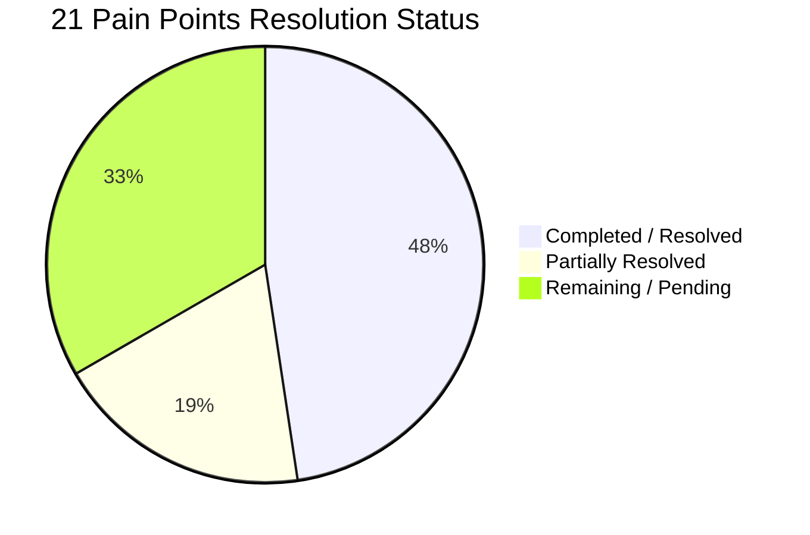

# Transport App: Implementation Status & Comprehensive Action Plan
*Audit & Progress Tracking against "Pain Points and How to Fix Them" (12 November 2026)*

---

## 1. Executive Summary & Progress Scorecard

Over the recent development sprints (commits `7338dd6` through `b71b73a`), the project was transformed from an unrunnable static prototype into a functional, building Android application with real-time Firebase services, hardened authentication, foreground location tracking, server-side push notifications, and modern MVVM architecture.

### Scorecard: 21 Pain Points
| Status | Count | Pain Points |
|---|:---:|---|
|  **Completed / Resolved** | **10** | **#2, #3, #4, #5, #6, #9, #11, #12, #19, #20** |
|  **Partially Resolved** | **4** | **#1, #8, #10, #17** |
|  **Remaining / Pending** | **7** | **#7, #13, #14, #15, #16, #18, #21** |



---

## 2. All 21 Pain Points: Audit & Status Matrix

| # | Severity | Pain Point Area | Review Finding | Status | Current Implementation State in Codebase |
|---|---|---|---|:---:|---|
| **1** | **Critical** | Child Safety | Parents matched to children by name |  **Partial** | Parents are now matched by **verified login email** (`parentEmail` in student record & `ParentEmails.normalize(user.getEmail())`), eliminating duplicate name collisions. *Pending: full account UID linking via invitation Cloud Function (`parentUids: [uid]`).* |
| **2** | **Critical** | Security | Open sign-up, client-set roles, rules not in repo |  **Resolved** | [firestore.rules](file:///c:/Users/Martin/Downloads/Transport-App/firestore.rules) & [firebase.json](file:///c:/Users/Martin/Downloads/Transport-App/firebase.json) added to repository. Server-side validation enforces role isolation; sign-up restricted to parent role; driver accounts linked via Cloud Function. |
| **3** | **Critical** | Safety | False "picked up" and "dropped off" alerts |  **Resolved** | Implemented [TripAlerts.java](file:///c:/Users/Martin/Downloads/Transport-App/app/src/main/java/com/example/transportapp/TripAlerts.java). Alerts send only the actual status recorded (`done`, `not_done`, `unmarked`), and unconfirmed children trigger immediate warnings to `schoolAlerts`. Grammar fixed in strings. |
| **4** | **High** | Safety | Checkbox list can record wrong child on scroll |  **Resolved** | In [StudentStatusAdapter.java](file:///c:/Users/Martin/Downloads/Transport-App/app/src/main/java/com/example/transportapp/StudentStatusAdapter.java), listeners are attached once in `onCreateViewHolder`, guarded by `holder.settingState` during binding, and index is resolved via `getBindingAdapterPosition()`. |
| **5** | **Medium** | Privacy | Personal data in logs; raw errors shown to users |  **Resolved** | ProGuard configured with `-assumenosideeffects class android.util.Log { public static int d(...); v(...); i(...); }` to strip verbose/debug logs with names and tokens from release APKs. Friendly user error messages. |
| **6** | **Critical** | Notifications | Push notifications never reach the phone |  **Resolved** | Replaced dead upstream API. Implemented [TransportMessagingService.java](file:///c:/Users/Martin/Downloads/Transport-App/app/src/main/java/com/example/transportapp/TransportMessagingService.java), [PushTokens.java](file:///c:/Users/Martin/Downloads/Transport-App/app/src/main/java/com/example/transportapp/PushTokens.java), declared `POST_NOTIFICATIONS` permission, and created `sendParentPush` Cloud Function in [functions/index.js](file:///c:/Users/Martin/Downloads/Transport-App/functions/index.js) using FCM HTTP v1. |
| **7** | **High** | Admin | Delete Student crashes or silently deletes nothing |  **Remaining** | [DeleteStudent.java](file:///c:/Users/Martin/Downloads/Transport-App/app/src/main/java/com/example/transportapp/DeleteStudent.java) accepts an Intent `studentId` extra but **no caller in the codebase shows a student picker before launching it**, so the ID is effectively uncontrolled. It deletes from root `students/{id}` (line 83) instead of subcollection `students/{grade}/studentList/{id}`. Dead code: unreachable `updateStudentData()` at line 54 also uses the wrong path. |
| **8** | **High** | Data | Screens read collections that are never written |  **Partial** | Fixed driver lookup to use `staff` and unified `vehicle`. *Remaining: Three separate mismatches in route data — (a) [AddRoute.java](file:///c:/Users/Martin/Downloads/Transport-App/app/src/main/java/com/example/transportapp/AddRoute.java) writes to `"Routes"` (capital); [RouteReportActivity.java](file:///c:/Users/Martin/Downloads/Transport-App/app/src/main/java/com/example/transportapp/RouteReportActivity.java) reads `"routes"` (lowercase) — a different Firestore collection; (b) [AddStudent.java](file:///c:/Users/Martin/Downloads/Transport-App/app/src/main/java/com/example/transportapp/AddStudent.java) `fetchRoutes()` and `checkVehicleCapacity()` also query `"Routes"` (capital); (c) `RouteReportActivity.java` reads field `"name"` (line 90) but `AddRoute.java` stores field `"routeName"` (line 117) — causing a NullPointerException in the spinner even if the collection name is fixed.* |
| **9** | **High** | Accounts | Sign-up dead end, no log-out, no saved session |  **Resolved** | Session restoration implemented in `MainActivity` (checks `FirebaseAuth.getCurrentUser()`) and `Login.resumeSession()`, which re-reads role from Firestore and routes to the correct home screen. [Session.java](file:///c:/Users/Martin/Downloads/Transport-App/app/src/main/java/com/example/transportapp/Session.java) provides the sign-out toolbar helper (clears tokens and redirects to `MainActivity`). Logout icon added to [toolbar.xml](file:///c:/Users/Martin/Downloads/Transport-App/app/src/main/res/layout/toolbar.xml); sign-up sends email verification. |
| **10** | **High** | Features | No live bus location, map or emergency SOS |  **Partial** | Implemented [TripLocationService.java](file:///c:/Users/Martin/Downloads/Transport-App/app/src/main/java/com/example/transportapp/TripLocationService.java) foreground GPS service (15 s / 20 m intervals) writing to `busGroups/{busId}`, and SOS emergency alert in [DriverLanding.java](file:///c:/Users/Martin/Downloads/Transport-App/app/src/main/java/com/example/transportapp/DriverLanding.java). [ParentLanding.java](file:///c:/Users/Martin/Downloads/Transport-App/app/src/main/java/com/example/transportapp/ParentLanding.java) already reads `lat`/`lng` from `busGroups` and launches the **native maps app** via `geo:` URI as a workaround. *Remaining: Embedded in-app map (Google Maps SDK or osmdroid) with live bus marker and ETA display — the external-app workaround is functional but not suitable for production UX.* |
| **11** | **High** | Features | Chat only shows messages on the sender's screen |  **Resolved** | [ChatActivity.java](file:///c:/Users/Martin/Downloads/Transport-App/app/src/main/java/com/example/transportapp/ChatActivity.java) now persists messages in Firestore under `busGroups/{busId}/messages` with real-time `addSnapshotListener`, sender UIDs, and timestamps. |
| **12** | **Medium** | Trips | Trip lifecycle gaps (open trips, pre-ticked, crashes) |  **Resolved** | Fixed Intent validation in [DropOff.java](file:///c:/Users/Martin/Downloads/Transport-App/app/src/main/java/com/example/transportapp/DropOff.java) (`if (!getIntentData()) finish()`); trip statuses start unticked; start/end times guarded against null arithmetic. |
| **13** | **Medium** | Data | Fragile data model (copied staff, text capacity) |  **Remaining** | [AddStudent.java](file:///c:/Users/Martin/Downloads/Transport-App/app/src/main/java/com/example/transportapp/AddStudent.java) copies staff names into student records; vehicle capacity is stored as String text; capacity check is not in a Firestore transaction. |
| **14** | **Medium** | Performance | Notification feed loads everything, unsorted |  **Remaining** | [FirestoreParentRepository.java](file:///c:/Users/Martin/Downloads/Transport-App/app/src/main/java/com/example/transportapp/FirestoreParentRepository.java) listens to all parent notifications without `.orderBy("timestamp", Query.Direction.DESCENDING).limit(50)` or pagination. |
| **15** | **High** | Release | Play Store blockers (package name, target SDK 36) |  **Remaining** | Application ID is still `com.example.transportapp` (must be updated in Gradle and Firebase); target SDK is 35 (needs evaluation for 36); published online privacy policy URL required. |
| **16** | **Low** | Build | Gradle 10 deprecations & dependencies outside catalog |  **Remaining** | `MPAndroidChart` and `firebase-messaging` are declared inline in [app/build.gradle.kts](file:///c:/Users/Martin/Downloads/Transport-App/app/build.gradle.kts) instead of [gradle/libs.versions.toml](file:///c:/Users/Martin/Downloads/Transport-App/gradle/libs.versions.toml); Firebase BoM not yet used. |
| **17** | **Medium** | Code Quality | All logic in activities as deeply nested callbacks |  **Partial** | Parent dashboard modernized with MVVM ([ParentDashboardViewModel.java](file:///c:/Users/Martin/Downloads/Transport-App/app/src/main/java/com/example/transportapp/ParentDashboardViewModel.java) & [ParentRepository.java](file:///c:/Users/Martin/Downloads/Transport-App/app/src/main/java/com/example/transportapp/ParentRepository.java)). *Remaining: School and Driver screens still have multi-level nested callbacks.* |
| **18** | **Medium** | Quality | Almost no tests and no CI workflow |  **Remaining** | Instrumented entry test [LaunchAndNavigationTest.java](file:///c:/Users/Martin/Downloads/Transport-App/app/src/androidTest/java/com/example/transportapp/LaunchAndNavigationTest.java) exists; missing GitHub Actions CI workflow (`.github/workflows/android.yml`) and ViewModel unit tests. |
| **19** | **Medium** | UX | Hard-coded text, oversized images, contrast, insets |  **Resolved** | Deleted 1.1MB & 2.2MB drawables; added WebPs in `drawable-nodpi`; fixed button contrast ratios in [colors.xml](file:///c:/Users/Martin/Downloads/Transport-App/app/src/main/res/values/colors.xml); centralized window insets via [SystemBars.java](file:///c:/Users/Martin/Downloads/Transport-App/app/src/main/java/com/example/transportapp/SystemBars.java); strings extracted. |
| **20** | **Medium** | UX | Dead back buttons, no loading or empty states |  **Resolved** | Standardized [toolbar.xml](file:///c:/Users/Martin/Downloads/Transport-App/app/src/main/res/layout/toolbar.xml) and wired navigation icons with `finish()` across all activities; added empty-state feedback in parent dashboard. |
| **21** | **Low** | UX | Driver screen hard to use on the road |  **Remaining** | Checkbox tap targets in `item_student_status.xml` remain small for moving vehicles; driver screen displays technical IDs (`driverId`); student ordering by stop route and QR code boarding not yet added. |

---

## 3. Accomplished Work: Technical Deep Dive

### 3.1 Security, Role-Based Access & Rules (#2, #5)
- **Firestore Security Rules**: Shipped [firestore.rules](file:///c:/Users/Martin/Downloads/Transport-App/firestore.rules) covering all collections (`users`, `staff`, `vehicle`, `Routes`, `routes`, `students`, `trips`, `notifications`, `schoolAlerts`, `busGroups`). Rules verify user roles server-side via `users/{uid}.role` and restrict student document access to the assigned parent email.
- **Privacy Hardening**: Set `android:allowBackup="false"` and added [network_security_config.xml](file:///c:/Users/Martin/Downloads/Transport-App/app/src/main/res/xml/network_security_config.xml). Added [PrivacyNotice.java](file:///c:/Users/Martin/Downloads/Transport-App/app/src/main/java/com/example/transportapp/PrivacyNotice.java) dialog and stripped release logging via ProGuard `-assumenosideeffects`.

### 3.2 Real-Time Push Notification Engine (#3, #6)
- **Token Registration**: [PushTokens.java](file:///c:/Users/Martin/Downloads/Transport-App/app/src/main/java/com/example/transportapp/PushTokens.java) captures FCM tokens upon sign-in and stores them in `users/{uid}/fcmTokens`.
- **FCM Service**: [TransportMessagingService.java](file:///c:/Users/Martin/Downloads/Transport-App/app/src/main/java/com/example/transportapp/TransportMessagingService.java) configures system notifications with `NotificationChannel`, handling foreground and background message display.
- **Cloud Functions**: [functions/index.js](file:///c:/Users/Martin/Downloads/Transport-App/functions/index.js) listens to `notifications/{notificationId}` and pushes notifications via FCM HTTP v1 API.
- **Guarded Trip Alerts**: [TripAlerts.java](file:///c:/Users/Martin/Downloads/Transport-App/app/src/main/java/com/example/transportapp/TripAlerts.java) ensures only students genuinely marked as picked up or dropped off generate success notifications; unmarked or missing students trigger alerts to `schoolAlerts`.

### 3.3 Live Driver Tracking & Emergency SOS (#10, #11)
- **Foreground Tracking**: [TripLocationService.java](file:///c:/Users/Martin/Downloads/Transport-App/app/src/main/java/com/example/transportapp/TripLocationService.java) runs as a foreground service with a persistent notification while trips are active, recording GPS coordinates to `busGroups/{busId}` every 15 seconds.
- **SOS Button**: Added emergency confirmation to [DriverLanding.java](file:///c:/Users/Martin/Downloads/Transport-App/app/src/main/java/com/example/transportapp/DriverLanding.java) that broadcasts instant emergency records to `schoolAlerts`.
- **Group Bus Chat**: [ChatActivity.java](file:///c:/Users/Martin/Downloads/Transport-App/app/src/main/java/com/example/transportapp/ChatActivity.java) reads and writes messages to `busGroups/{busId}/messages` with real-time listeners.

### 3.4 Modern Architecture, UI & Performance (#4, #9, #19, #20)
- **MVVM Pattern**: Built [ParentDashboardViewModel.java](file:///c:/Users/Martin/Downloads/Transport-App/app/src/main/java/com/example/transportapp/ParentDashboardViewModel.java) and [FirestoreParentRepository.java](file:///c:/Users/Martin/Downloads/Transport-App/app/src/main/java/com/example/transportapp/FirestoreParentRepository.java) to decouple data fetching from UI controllers.
- **Session Management**: `MainActivity` checks `FirebaseAuth.getCurrentUser()` on launch and calls `Login.resumeSession()` to re-read the user's role from Firestore and route directly to the correct dashboard. [Session.java](file:///c:/Users/Martin/Downloads/Transport-App/app/src/main/java/com/example/transportapp/Session.java) is a sign-out toolbar helper that clears FCM tokens and redirects back to `MainActivity`.
- **Clean Naming**: Renamed `Navigation` to [RoleSelectActivity.java](file:///c:/Users/Martin/Downloads/Transport-App/app/src/main/java/com/example/transportapp/RoleSelectActivity.java).
- **Reusable Layouts**: Extracted shared [toolbar.xml](file:///c:/Users/Martin/Downloads/Transport-App/app/src/main/res/layout/toolbar.xml) and [footer.xml](file:///c:/Users/Martin/Downloads/Transport-App/app/src/main/res/layout/footer.xml).
- **Theme & Contrast**: Added full dark theme palette in [values-night/colors.xml](file:///c:/Users/Martin/Downloads/Transport-App/app/src/main/res/values-night/colors.xml) and updated buttons to meet WCAG 4.5:1 contrast.
- **Memory Fix**: Replaced oversized 1.1MB JPEG and 2.2MB PNG with optimized WebP drawables in [drawable-nodpi](file:///c:/Users/Martin/Downloads/Transport-App/app/src/main/res/drawable-nodpi).

---

## 4. Prioritized Execution Plan for Remaining Items

```mermaid
flowchart TD
    subgraph Phase 1: High Priority Data & Crash Fixes
        P1_1[Fix DeleteStudent Subcollection Path #7]
        P1_2[Unify Routes Collection Naming #8]
        P1_3[Add OrderBy and Limit to Notification Query #14]
        P1_4[Clean Gradle Dependencies & BoM #16]
    end

    subgraph Phase 2: Live Map & Parent ETA
        P2_1[Integrate MapView in Parent Dashboard #10]
        P2_2[Render Bus Position from busGroups/{busId} #10]
        P2_3[Display Dynamic Trip ETA #10]
    end

    subgraph Phase 3: Data Integrity & Architecture
        P3_1[Add UID-based Parent Linking #1]
        P3_2[Firestore Transactions for Capacity #13]
        P3_3[Merge PickUp and DropOff into TripActivity #17]
    end

    subgraph Phase 4: Release & Quality
        P4_1[Setup GitHub Actions CI Workflow #18]
        P4_2[Production Package Name Migration #15]
        P4_3[Driver Road UX & Big Touch Targets #21]
    end

    Phase 1 --> Phase 2 --> Phase 3 --> Phase 4
```

### Phase 1: High Priority Data & Crash Fixes (Immediate)
- [ ] **1.1 Fix Delete Student Flow (#7)**:
  - Update [DeleteStudent.java](file:///c:/Users/Martin/Downloads/Transport-App/app/src/main/java/com/example/transportapp/DeleteStudent.java) to show a searchable student list (mirroring `ModifyStudent`) before the delete action — no caller currently passes a valid ID.
  - Delete records from the real path: `students/{grade}/studentList/{studentId}` instead of root `students/{studentId}` (line 83).
  - Remove dead `updateStudentData()` method (line 54) which also uses the wrong path.
  - Guard against null IDs to prevent silent Firestore failures.
- [ ] **1.2 Unify Route Collection Naming & Field Names (#8)**:
  - Create a centralized constants class (`Collections.java` or update `BusGroups.java`) defining `ROUTES = "routes"` and `FIELD_ROUTE_NAME = "routeName"`.
  - Fix [AddRoute.java](file:///c:/Users/Martin/Downloads/Transport-App/app/src/main/java/com/example/transportapp/AddRoute.java) line 125: change `"Routes"` → `"routes"`.
  - Fix [AddStudent.java](file:///c:/Users/Martin/Downloads/Transport-App/app/src/main/java/com/example/transportapp/AddStudent.java) `fetchRoutes()` (line 71) and `checkVehicleCapacity()` (line 117): change `"Routes"` → `"routes"`.
  - Fix [RouteReportActivity.java](file:///c:/Users/Martin/Downloads/Transport-App/app/src/main/java/com/example/transportapp/RouteReportActivity.java) line 90: change field read from `"name"` → `"routeName"` to match what `AddRoute` stores — without this fix the route spinner will throw a NullPointerException even after the collection name is corrected.
- [ ] **1.3 Optimize Parent Notification Query (#14)**:
  - Update `listenToNotifications` in [FirestoreParentRepository.java](file:///c:/Users/Martin/Downloads/Transport-App/app/src/main/java/com/example/transportapp/FirestoreParentRepository.java):
    ```java
    db.collection(TripAlerts.COLLECTION_NOTIFICATIONS)
      .whereEqualTo("parentEmail", parentEmail)
      .orderBy("timestamp", Query.Direction.DESCENDING)
      .limit(50)
    ```
- [ ] **1.4 Version Catalog & Firebase BoM (#16)**:
  - Move `MPAndroidChart` and `firebase-messaging` into [gradle/libs.versions.toml](file:///c:/Users/Martin/Downloads/Transport-App/gradle/libs.versions.toml).
  - Adopt `platform(libs.firebase.bom)` in [app/build.gradle.kts](file:///c:/Users/Martin/Downloads/Transport-App/app/build.gradle.kts) to lock Firebase library versions.

### Phase 2: Live Bus Map & Tracking Visualization (Features)
- [ ] **2.1 Embedded Parent Map View (#10)**:
  - Add Google Maps SDK or OpenStreetMap (`osmdroid`) dependency.
  - Replace the existing `geo:` URI native-maps workaround in [ParentLanding.java](file:///c:/Users/Martin/Downloads/Transport-App/app/src/main/java/com/example/transportapp/ParentLanding.java) with an embedded `MapView` / `SupportMapFragment` in a dedicated `LiveTrackingActivity`.
  - Subscribe to `busGroups/{busId}` real-time listener (`lat`, `lng`, `active`, `updatedAtMillis`) and animate bus marker continuously while trip is active.
  - Calculate and display distance and estimated time of arrival (ETA).

### Phase 3: Data Architecture & Trip Consolidation (Integrity)
- [ ] **3.1 UID-based Parent Linking (#1)**:
  - Transition from email-only linking to `parentUids: [uid]` arrays on student records via an invitation Cloud Function.
- [ ] **3.2 Transactional Capacity Check (#13)**:
  - Store vehicle capacity as an integer (`int`).
  - Wrap student addition in a Firestore transaction (`db.runTransaction(...)`) to guarantee vehicles are not overfilled by concurrent writes.
  - Reference `staffId`, `vehicleId`, and `routeId` instead of duplicating names.
- [ ] **3.3 Merge PickUp and DropOff (#17)**:
  - Refactor `PickUp.java` and `DropOff.java` into a single `TripActivity.java` with a mode flag (`MODE_PICKUP` / `MODE_DROPOFF`) and a dedicated `TripViewModel`.

### Phase 4: CI/CD, Tests & Release Readiness (Launch)
- [ ] **4.1 GitHub Actions Workflow (#18)**:
  - Create `.github/workflows/android.yml` to automatically run `./gradlew assembleDebug testDebugUnitTest lint` on pull requests and pushes to `main`.
  - Add unit tests for `ParentDashboardViewModel`, `TripAlerts`, and `ParentEmails`.
- [ ] **4.2 Driver Road Experience Polish (#21)**:
  - Replace small checkboxes in `item_student_status.xml` with large status chips or buttons (Not Yet / Boarded / Absent).
  - Hide internal technical IDs on `activity_driver_landing.xml`.
  - Order student checklist by route stop sequence.
- [ ] **4.3 Google Play Release Identity (#15)**:
  - Migrate package ID from `com.example.transportapp` to production ID (e.g., `com.safeschool.transport`).
  - Update Google Cloud Console and Firebase app registration with the new package name and updated `google-services.json`.
  - Raise `targetSdk` to 36 and publish privacy policy documentation.
