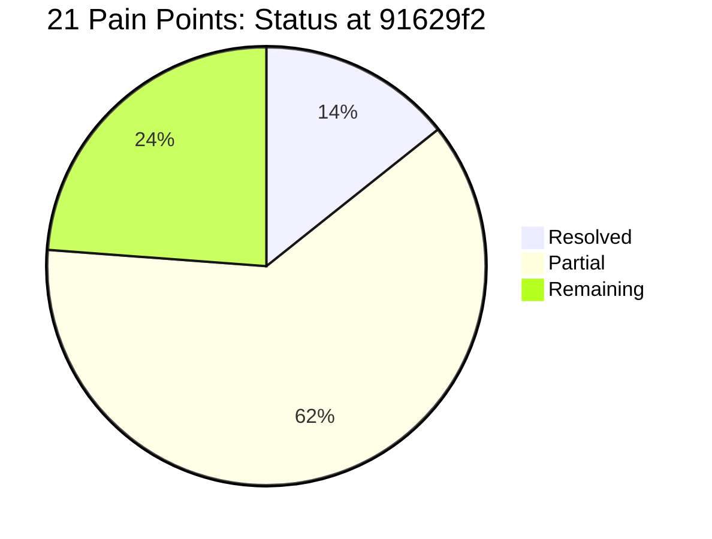

# Transport App: Implementation Status & Comprehensive Action Plan
*Audit & Progress Tracking against "Pain Points and How to Fix Them" (12 November 2026); sections 1–2 re-audited 13 November 2026*

---

## 1. Executive Summary & Progress Scorecard

*Re-audited against the code at commit `91629f2` on 13 November 2026. Every status below was checked in the source, not taken from commit messages.*

Since the review (commit `a268108`), the app has gone from static screens to a working Firebase app. The three most dangerous problems are fixed in code:
- Alerts now report the status the driver actually marked.
- The pick-up list can no longer record a status against the wrong child.
- Push notifications go out through a Cloud Function.

Parents are matched to children by verified email instead of typed name. Sign-in remembers the user and has sign-out. Drivers share their live location and have an SOS button, and chat is stored in Firestore. Section 5 of the earlier review (contrast, dark mode, insets, images) is done.

Most items are **partly** done. The core risk is usually closed, but part of the review's fix is still missing. Five items are untouched. Three of them affect data integrity or release: Delete Student (#7), the data model (#13) and the Play Store blockers (#15).

**How statuses are counted**
- **Resolved:** every part of the review's "How to fix" is in the code.
- **Partial:** some of it is in the code; the gap is named in the matrix.
- **Remaining:** nothing meaningful has changed.

### Scorecard: 21 Pain Points
| Status | Count | Pain Points |
|---|:---:|---|
| ✅ **Resolved** | **3** | #4, #6, #19 |
| 🟡 **Partial** | **13** | #1, #2, #3, #5, #8, #9, #10, #11, #12, #14, #17, #18, #20 |
| 🔴 **Remaining** | **5** | #7, #13, #15, #16, #21 |

**Small gaps.** In four partial items the safety or privacy risk is closed and only a small piece is left:
- #3: no end-of-day check for children never dropped off.
- #9: Login and Sign Up still trim spaces from passwords.
- #11: no push notification when a chat message arrives.
- #14: the cap and sort happen on the phone, not in the query.

**Not yet in effect.** These changes are written but not live:
- The Cloud Functions (#6, #10, #11) and the rules (#2) work only after `firebase deploy --only firestore:rules,firestore:indexes,functions` (Blaze plan).
- `firestore.rules`, the unit tests and the rules tests are excluded by `.gitignore`, so they are on this machine only (#2, #18).



---

## 2. All 21 Pain Points: Audit & Status Matrix

File paths are relative to the repository root. Java files are in `app/src/main/java/com/example/transportapp/`.

| # | Severity | Area | Review finding | Status | What the code does now | What is still missing |
|---|---|---|---|:---:|---|---|
| **1** | Critical | Security | Parents matched to children by full name | 🟡 Partial | Children and alerts are matched by the parent's **verified login email** (`FirestoreParentRepository` queries `parentEmail`). Names are never used for access, and `firestore.rules` checks `email_verified`. | Linking by account UID through an invitation (`parentUids: [uid]`) is not built. Matching relies on the school typing the right email. |
| **2** | Critical | Security | Open sign-up, client-set roles, rules not in the repo | 🟡 Partial | `firestore.rules` is written. Sign-up can only create a `parent` profile, and users cannot change `role` or `staffId`. Drivers are promoted server-side by the `linkStaffAccount` function. Each role sees only its own data. 55 emulator tests pass. `firebase.json` and `firestore.indexes.json` are in the repo. | **`firestore.rules` is in `.gitignore`, so it is not in the repo.** No school invite code at sign-up. Roles live on the user document, not as custom claims (acceptable, since only the server can write them). API key restriction can't be checked from code. |
| **3** | Critical | Safety | Alerts sent even for children marked "not picked" | 🟡 Partial | `TripAlerts.java` sends each parent the status actually recorded (`done`, `not_done`, `unmarked`). Any child not confirmed also goes to `schoolAlerts`. Completing a trip with unmarked children asks the driver first. The message text is fixed. | No end-of-day check that raises an urgent school alert for a child picked up but never dropped off. |
| **4** | High | Safety | Scrolling the list can save a status against the wrong child | ✅ Resolved | `StudentStatusAdapter` ignores changes made while a row is being filled in (`settingState`). It finds the child with `getBindingAdapterPosition()` at the moment of the tap. | — |
| **5** | Medium | Privacy | Personal data in logs; raw errors shown to users | 🟡 Partial | R8 strips `Log.d/v/i` from release builds (`app/proguard-rules.pro`), so the name-bearing debug logs are gone from release APKs. | **35 toasts still show raw `e.getMessage()` text** (e.g. `AddRoute`, `AddStaff`). The remaining `Log.w/e` calls are not reviewed for personal data. |
| **6** | Critical | Notifications | Push notifications never arrive | ✅ Resolved | The shut-down `FirebaseMessaging.send()` is gone. `PushTokens` saves device tokens to `users/{uid}.fcmTokens`, `TransportMessagingService` shows and refreshes them, and `POST_NOTIFICATIONS` is requested. The `sendParentPush` function delivers through FCM HTTP v1 and removes dead tokens. | Takes effect once the functions are deployed. |
| **7** | High | Admin | Delete Student crashes or deletes nothing | 🔴 Remaining | `SchoolLanding` still opens `DeleteStudent` with no `studentId`, so confirming calls `document(null)`. Both reads and deletes use `students/{id}` (lines 55, 83) instead of `students/{grade}/studentList/{id}`. | Student picker, the correct path, a test, and archiving instead of deleting. |
| **8** | High | Data | Screens read collections that are never written | 🟡 Partial | Driver lookups use `staff`. Device tokens come from `users`, and nothing reads `drivers` or `parents` any more. Bus location and chat use one `busGroups` collection (`BusGroups.java`). | `AddRoute`/`AddStudent` write `Routes` while `RouteReportActivity` reads `routes`, **and reads field `name` where `AddRoute` writes `routeName`**. `StudentReportActivity` reads `attendance/…/records`, which nothing writes. `vehicle` is still singular, and there is no shared collection-name constants class. |
| **9** | High | Accounts | Sign-up dead end, no log-out, no saved session | 🟡 Partial | Sign-up goes to Login, which runs the role lookup. `MainActivity` sends a signed-in user straight to their home screen through `Login.resumeSession()`, and the role is always re-read from the server. Each home screen can sign out (`Session.java`: removes the token, clears the back stack, stops driver location). The role picker is only a hint. Drivers are linked by `staffId`, not name. Password reset works. | Login and Sign Up still `.trim()` the password. |
| **10** | High | Features | No live bus location, map or SOS | 🟡 Partial | `TripLocationService` is a foreground GPS service (15 s / 20 m) that writes to `busGroups/{bus}` during a trip and clears it at the end. `clearStaleBusLocations` clears stale positions after 30 min. SOS in `DriverLanding` alerts the school and parents. The location permissions are declared. "Where is the bus?" opens the phone's maps app (`geo:` link). | No in-app map with a live marker and no ETA. Play Console location declaration not done. |
| **11** | High | Features | Chat only shows messages on the sender's screen | 🟡 Partial | `ChatActivity` stores messages in `busGroups/{bus}/messages` with sender UID and server timestamp, with a live listener. Parents have a "Message the bus" button. | No push notification to the other side when a message arrives. |
| **12** | Medium | Trips | Open trips, pre-ticked drop-offs, null crash | 🟡 Partial | Drop-off starts with every child unticked. `DropOff.getIntentData()` returns a boolean and stops on failure. Both screens guard a null start time. | A trip is still **created as soon as PickUp/DropOff opens**. There is no Start trip button, no limit of one active trip per vehicle, and no warning when leaving an active trip. |
| **13** | Medium | Data | Copied staff details, text capacity, no transactions | 🔴 Remaining | `AddStudent` still copies `driverName`/`attendantName` into each student. `capacity` is a string parsed with `Integer.parseInt`. The capacity check and the save are separate steps. Staff IDs are licence numbers (`AddStaff` line 143). | References instead of copies, numeric fields, a transaction, generated IDs. |
| **14** | Medium | Performance | Notification feed loads everything, unsorted | 🟡 Partial | `ParentDashboardViewModel.newestFirst()` sorts newest first and shows at most 50. | The Firestore query still downloads **every** notification (no `orderBy`/`limit`, no composite index). No `ListAdapter`/`DiffUtil` (`ChildAdapter` calls `notifyDataSetChanged()`). No "load more" or read state. |
| **15** | High | Release | Play Store blockers | 🔴 Remaining | `applicationId` is `com.example.transportapp`; `compileSdk`/`targetSdk` are 35. A privacy notice exists in the app (`PrivacyNotice.java`, still a draft with gaps). | Real package name plus new `google-services.json`, SDK 36, a published privacy policy URL, the Data safety form. |
| **16** | Low | Build | Gradle 10 deprecations, dependencies outside the catalog | 🔴 Remaining | Gradle 9.1.0 / AGP 8.13.2. MPAndroidChart and `firebase-messaging:23.3.1` are still inline in `app/build.gradle.kts` (lines 68–69), and there is no Firebase BoM. `.idea/` files are still tracked. | Fix `--warning-mode all` warnings, move everything to `libs.versions.toml`, add the BoM, untrack `.idea`. |
| **17** | Medium | Code quality | All logic in activities as nested callbacks | 🟡 Partial | The parent dashboard uses ViewModel + Repository (`ParentDashboardViewModel`, `ParentRepository`, `FirestoreParentRepository`). | School, Driver, admin and report screens still nest Firestore calls. `PickUp` (325 lines) and `DropOff` (346 lines) are still near-duplicates. Driver details still travel in Intent extras. |
| **18** | Medium | Quality | Almost no tests and no CI | 🟡 Partial | 11 ViewModel unit tests (`ParentDashboardViewModelTest`) and the launch test (`LaunchAndNavigationTest`) pass. 55 Firestore rules tests pass in the emulator. | **The unit tests and rules tests are excluded by `.gitignore`**, and the rules tests live outside the repo. No `.github/workflows` CI. No tests for login routing or the driver flow. |
| **19** | Medium | UX | Hard-coded text, oversized images, contrast, insets | ✅ Resolved | No hard-coded `android:text` remains in layouts. The footer year comes from the clock. The 2560 px and 2.2 MB photos were replaced by 1080 px JPEGs in `drawable-nodpi` (310 KB together). Buttons meet 4.5:1 (orange `#B45309`, green `#1B6B1B`). Every screen applies window insets (`SystemBars.java`). There is a dark theme (`values-night/colors.xml`). | Some toast messages in Java are still hard-coded English. |
| **20** | Medium | UX | Dead back buttons, no loading or empty states | 🟡 Partial | Every toolbar back arrow works (`TransportApp` wires any arrow without its own handler). Home screens show sign-out instead. Login shows a spinner. The parent dashboard has loading and empty-state text. | No progress indicators on School, Driver, admin or report screens. Admin lists still use a short "No … found" toast. No pull-to-refresh. |
| **21** | Low | UX | Driver screen hard to use on the road | 🔴 Remaining | `item_student_status.xml` still uses standard `wrap_content` checkboxes. `DriverLanding` shows "Driver ID" and "Email" (lines 74–75). | Large tap targets, child photos, ordering by stop, hiding IDs, optional QR boarding. |

---

## 3. Accomplished Work: Technical Deep Dive

### 3.1 Security, Role-Based Access & Rules (#2, #5)
- **Firestore Security Rules**: Shipped [firestore.rules](file:///c:/Users/Martin/Downloads/Transport-App/firestore.rules) covering all collections (`users`, `staff`, `vehicle`, `Routes`, `routes`, `students`, `trips`, `notifications`, `schoolAlerts`, `busGroups`). Rules verify user roles server-side via `users/{uid}.role` and restrict student document access to the assigned parent email.
- **Privacy Hardening**: Set `android:allowBackup="false"` and added [network_security_config.xml](file:///c:/Users/Martin/Downloads/Transport-App/app/src/main/res/xml/network_security_config.xml). Added [PrivacyNotice.java](file:///c:/Users/Martin/Downloads/Transport-App/app/src/main/java/com/example/transportapp/PrivacyNotice.java) dialog and stripped release logging via ProGuard `-assumenosideeffects`.

### 3.2 Real-Time Push Notification Engine (#3, #6)
- **Token Registration**: [PushTokens.java](file:///c:/Users/Martin/Downloads/Transport-App/app/src/main/java/com/example/transportapp/PushTokens.java) captures FCM tokens upon sign-in and stores them in `users/{uid}/fcmTokens`.
- **FCM Service**: [TransportMessagingService.java](file:///c:/Users/Martin/Downloads/Transport-App/app/src/main/java/com/example/transportapp/TransportMessagingService.java) configures system notifications with `NotificationChannel`, handling foreground and background message display.
- **Cloud Functions**: [functions/index.js](file:///c:/Users/Martin/Downloads/Transport-App/functions/index.js) listens to `notifications/{notificationId}` and pushes notifications via FCM HTTP v1 API.
- **Guarded Trip Alerts**: [TripAlerts.java](file:///c:/Users/Martin/Downloads/Transport-App/app/src/main/java/com/example/transportapp/TripAlerts.java) ensures only students genuinely marked as picked up or dropped off generate success notifications; unmarked or missing students trigger alerts to `schoolAlerts`.

### 3.3 Live Driver Tracking & Emergency SOS (#10, #11)
- **Foreground Tracking**: [TripLocationService.java](file:///c:/Users/Martin/Downloads/Transport-App/app/src/main/java/com/example/transportapp/TripLocationService.java) runs as a foreground service with a persistent notification while trips are active, recording GPS coordinates to `busGroups/{busId}` every 15 seconds.
- **SOS Button**: Added emergency confirmation to [DriverLanding.java](file:///c:/Users/Martin/Downloads/Transport-App/app/src/main/java/com/example/transportapp/DriverLanding.java) that broadcasts instant emergency records to `schoolAlerts`.
- **Group Bus Chat**: [ChatActivity.java](file:///c:/Users/Martin/Downloads/Transport-App/app/src/main/java/com/example/transportapp/ChatActivity.java) reads and writes messages to `busGroups/{busId}/messages` with real-time listeners.

### 3.4 Modern Architecture, UI & Performance (#4, #9, #19, #20)
- **MVVM Pattern**: Built [ParentDashboardViewModel.java](file:///c:/Users/Martin/Downloads/Transport-App/app/src/main/java/com/example/transportapp/ParentDashboardViewModel.java) and [FirestoreParentRepository.java](file:///c:/Users/Martin/Downloads/Transport-App/app/src/main/java/com/example/transportapp/FirestoreParentRepository.java) to decouple data fetching from UI controllers.
- **Session Management**: `MainActivity` checks `FirebaseAuth.getCurrentUser()` on launch and calls `Login.resumeSession()` to re-read the user's role from Firestore and route directly to the correct dashboard. [Session.java](file:///c:/Users/Martin/Downloads/Transport-App/app/src/main/java/com/example/transportapp/Session.java) is a sign-out toolbar helper that clears FCM tokens and redirects back to `MainActivity`.
- **Clean Naming**: Renamed `Navigation` to [RoleSelectActivity.java](file:///c:/Users/Martin/Downloads/Transport-App/app/src/main/java/com/example/transportapp/RoleSelectActivity.java).
- **Reusable Layouts**: Extracted shared [toolbar.xml](file:///c:/Users/Martin/Downloads/Transport-App/app/src/main/res/layout/toolbar.xml) and [footer.xml](file:///c:/Users/Martin/Downloads/Transport-App/app/src/main/res/layout/footer.xml).
- **Theme & Contrast**: Added full dark theme palette in [values-night/colors.xml](file:///c:/Users/Martin/Downloads/Transport-App/app/src/main/res/values-night/colors.xml) and updated buttons to meet WCAG 4.5:1 contrast.
- **Memory Fix**: Replaced oversized 1.1MB JPEG and 2.2MB PNG with optimized WebP drawables in [drawable-nodpi](file:///c:/Users/Martin/Downloads/Transport-App/app/src/main/res/drawable-nodpi).

---

## 4. Prioritized Execution Plan for Remaining Items

```mermaid
flowchart TD
    subgraph Phase 1: High Priority Data & Crash Fixes
        P1_1[Fix DeleteStudent Subcollection Path #7]
        P1_2[Unify Routes Collection Naming #8]
        P1_3[Add OrderBy and Limit to Notification Query #14]
        P1_4[Clean Gradle Dependencies & BoM #16]
    end

    subgraph Phase 2: Live Map & Parent ETA
        P2_1[Integrate MapView in Parent Dashboard #10]
        P2_2[Render Bus Position from busGroups/{busId} #10]
        P2_3[Display Dynamic Trip ETA #10]
    end

    subgraph Phase 3: Data Integrity & Architecture
        P3_1[Add UID-based Parent Linking #1]
        P3_2[Firestore Transactions for Capacity #13]
        P3_3[Merge PickUp and DropOff into TripActivity #17]
    end

    subgraph Phase 4: Release & Quality
        P4_1[Setup GitHub Actions CI Workflow #18]
        P4_2[Production Package Name Migration #15]
        P4_3[Driver Road UX & Big Touch Targets #21]
    end

    Phase 1 --> Phase 2 --> Phase 3 --> Phase 4
```

### Phase 1: High Priority Data & Crash Fixes (Immediate)
- [ ] **1.1 Fix Delete Student Flow (#7)**:
  - Update [DeleteStudent.java](file:///c:/Users/Martin/Downloads/Transport-App/app/src/main/java/com/example/transportapp/DeleteStudent.java) to show a searchable student list (mirroring `ModifyStudent`) before the delete action — no caller currently passes a valid ID.
  - Delete records from the real path: `students/{grade}/studentList/{studentId}` instead of root `students/{studentId}` (line 83).
  - Remove dead `updateStudentData()` method (line 54) which also uses the wrong path.
  - Guard against null IDs to prevent silent Firestore failures.
- [ ] **1.2 Unify Route Collection Naming & Field Names (#8)**:
  - Create a centralized constants class (`Collections.java` or update `BusGroups.java`) defining `ROUTES = "routes"` and `FIELD_ROUTE_NAME = "routeName"`.
  - Fix [AddRoute.java](file:///c:/Users/Martin/Downloads/Transport-App/app/src/main/java/com/example/transportapp/AddRoute.java) line 125: change `"Routes"` → `"routes"`.
  - Fix [AddStudent.java](file:///c:/Users/Martin/Downloads/Transport-App/app/src/main/java/com/example/transportapp/AddStudent.java) `fetchRoutes()` (line 71) and `checkVehicleCapacity()` (line 117): change `"Routes"` → `"routes"`.
  - Fix [RouteReportActivity.java](file:///c:/Users/Martin/Downloads/Transport-App/app/src/main/java/com/example/transportapp/RouteReportActivity.java) line 90: change field read from `"name"` → `"routeName"` to match what `AddRoute` stores — without this fix the route spinner will throw a NullPointerException even after the collection name is corrected.
- [ ] **1.3 Optimize Parent Notification Query (#14)**:
  - Update `listenToNotifications` in [FirestoreParentRepository.java](file:///c:/Users/Martin/Downloads/Transport-App/app/src/main/java/com/example/transportapp/FirestoreParentRepository.java):
    ```java
    db.collection(TripAlerts.COLLECTION_NOTIFICATIONS)
      .whereEqualTo("parentEmail", parentEmail)
      .orderBy("timestamp", Query.Direction.DESCENDING)
      .limit(50)
    ```
- [ ] **1.4 Version Catalog & Firebase BoM (#16)**:
  - Move `MPAndroidChart` and `firebase-messaging` into [gradle/libs.versions.toml](file:///c:/Users/Martin/Downloads/Transport-App/gradle/libs.versions.toml).
  - Adopt `platform(libs.firebase.bom)` in [app/build.gradle.kts](file:///c:/Users/Martin/Downloads/Transport-App/app/build.gradle.kts) to lock Firebase library versions.

### Phase 2: Live Bus Map & Tracking Visualization (Features)
- [ ] **2.1 Embedded Parent Map View (#10)**:
  - Add Google Maps SDK or OpenStreetMap (`osmdroid`) dependency.
  - Replace the existing `geo:` URI native-maps workaround in [ParentLanding.java](file:///c:/Users/Martin/Downloads/Transport-App/app/src/main/java/com/example/transportapp/ParentLanding.java) with an embedded `MapView` / `SupportMapFragment` in a dedicated `LiveTrackingActivity`.
  - Subscribe to `busGroups/{busId}` real-time listener (`lat`, `lng`, `active`, `updatedAtMillis`) and animate bus marker continuously while trip is active.
  - Calculate and display distance and estimated time of arrival (ETA).

### Phase 3: Data Architecture & Trip Consolidation (Integrity)
- [ ] **3.1 UID-based Parent Linking (#1)**:
  - Transition from email-only linking to `parentUids: [uid]` arrays on student records via an invitation Cloud Function.
- [ ] **3.2 Transactional Capacity Check (#13)**:
  - Store vehicle capacity as an integer (`int`).
  - Wrap student addition in a Firestore transaction (`db.runTransaction(...)`) to guarantee vehicles are not overfilled by concurrent writes.
  - Reference `staffId`, `vehicleId`, and `routeId` instead of duplicating names.
- [ ] **3.3 Merge PickUp and DropOff (#17)**:
  - Refactor `PickUp.java` and `DropOff.java` into a single `TripActivity.java` with a mode flag (`MODE_PICKUP` / `MODE_DROPOFF`) and a dedicated `TripViewModel`.

### Phase 4: CI/CD, Tests & Release Readiness (Launch)
- [ ] **4.1 GitHub Actions Workflow (#18)**:
  - Create `.github/workflows/android.yml` to automatically run `./gradlew assembleDebug testDebugUnitTest lint` on pull requests and pushes to `main`.
  - Add unit tests for `ParentDashboardViewModel`, `TripAlerts`, and `ParentEmails`.
- [ ] **4.2 Driver Road Experience Polish (#21)**:
  - Replace small checkboxes in `item_student_status.xml` with large status chips or buttons (Not Yet / Boarded / Absent).
  - Hide internal technical IDs on `activity_driver_landing.xml`.
  - Order student checklist by route stop sequence.
- [ ] **4.3 Google Play Release Identity (#15)**:
  - Migrate package ID from `com.example.transportapp` to production ID (e.g., `com.safeschool.transport`).
  - Update Google Cloud Console and Firebase app registration with the new package name and updated `google-services.json`.
  - Raise `targetSdk` to 36 and publish privacy policy documentation.
