# Implementation Plan: Point 1 — Build and Project Setup

## Executive Summary
This document provides a detailed, production-grade engineering plan to execute **Point 1: Build and project setup** from the *School Transport Child Safety App Review and Recommendations* report.

The primary objective is to transform the existing mobile codebase into a reproducible, stable, secure, and clean Android build foundation that compiles from the command line, enforces secure defaults, eliminates asset-decoding crashes, and prevents navigation regressions.

---

## 1. Baseline Audit & Gap Analysis

Based on our inspection of the current repository against the findings on Pages 2–3 of the review document:

| PDF Sub-Item | Severity | Current Status in Repo | Action Required |
|---|---|---|---|
| **1.1 Launch screen declaration** (`AndroidManifest.xml`) | **Critical** | Partially Addressed (`MainActivity` now has MAIN/LAUNCHER filter) | Enforce `allowBackup="false"` for child data protection; verify all 20+ activities are declared and unexported where appropriate. |
| **1.2 Role picker crash prevention** (`MainActivity.java`) | **Critical** | Navigation wired; no automated test | Implement an Espresso instrumented test verifying `MainActivity` -> `Navigation` transition without `ActivityNotFoundException`. |
| **1.3 Gradle wrapper files** (root) | **Critical** | Wrapper files present in repo | Ensure `.gitignore` explicitly prevents `gradle-wrapper.jar` from being ignored (`!gradle/wrapper/gradle-wrapper.jar`); document `JAVA_HOME` configuration. |
| **1.4 Wrong image file extensions** (`res/drawable/`) | **High** | **Active Defect** | `notification.jpg` is raw SVG (causes inflation errors); `school.jpg` is AVIF (crashes Android < 12, minSdk is 24); `attendant.jpg` is WebP; `clock.jpg` & `tracking.jpg` are PNGs; `driver_image.png` is JPEG. Must be converted/renamed. |
| **1.5 Launcher icon resources** (`res/mipmap-*`) | **High** | Generic icons present | Ensure brand adaptive icons (`ic_launcher`, `ic_launcher_round`) feature a bus or safety shield motif in brand green (`#228B22`). |
| **1.6 Leftover templates & missing dependencies** | **Medium** | Partial cleanup done | Add explicit dependencies for `androidx.recyclerview:recyclerview` and `androidx.cardview:cardview` to `libs.versions.toml`; remove dead template file `refs.xml`. |
| **1.7 Release build and publishing identity** | **Medium** | **Active Defect** | Package ID is `com.example.transportapp` (rejected by Google Play); `isMinifyEnabled = false`; no R8 shrinking or ProGuard rules for Firebase/charts. |
| **1.8 `local.properties` in version control** | **Low** | Verified Clean | In `.gitignore` and untracked. Add safeguarding rules for release keystores and local secrets. |

---

## 2. Architecture & Design Decisions

```mermaid
flowchart TD
    subgraph Phase 1: Asset Normalization
        A1[notification.jpg SVG] -->|Convert to XML| V1[ic_notification.xml VectorDrawable]
        A2[school.jpg AVIF] -->|Transcode to WebP/PNG| V2[school.png / school.webp API 24+]
        A3[Mislabelled jpg/png/webp] -->|Rename & Fix Header| V3[Genuine Extensions]
        V1 & V2 & V3 --> L1[Update XML Layout References]
    end

    subgraph Phase 2: Manifest & Navigation Testing
        M1[AndroidManifest.xml] -->|Set allowBackup=false| M2[Security Hardening]
        M2 --> T1[Espresso Test: MainActivityTest]
        T1 -->|Verify Get Started Tap| T2[Navigation Activity Launch]
    end

    subgraph Phase 3: Build & Dependencies
        G1[libs.versions.toml] -->|Add RecyclerView & CardView| G2[app/build.gradle.kts]
        G2 -->|Configure R8 & ShrinkResources| G3[Release Build Configuration]
        G3 --> P1[ProGuard Rules for Firebase & Models]
    end
```



### Key Technical Decisions:
1. **Asset Transcoding Strategy**:
   - `notification.jpg`: The current file contains raw SVG vector markup. We will convert it into a native Android `VectorDrawable` XML (`ic_notification.xml`) so it scales cleanly across all screen densities without bitmap distortion.
   - `school.jpg`: Decoded currently as AVIF (`ftypavif`). AVIF is only natively supported on Android 12 (API 31)+. Because the project target `minSdk` is 24 (Android 7.0), this image will fail to decode on earlier devices. We will transcode it to standard PNG or lossless WebP.
   - Mismatched raster formats (`clock.jpg`, `tracking.jpg`, `attendant.jpg`, etc.) will be renamed to match their real container format, and all XML layouts will be updated to point to the correct drawables.
2. **Security Hardening (`allowBackup="false"`)**:
   - Because this application manages student names, routes, attendance, and driver details, enabling full ADB backup poses a sensitive data exposure vulnerability. Setting `android:allowBackup="false"` prevents unauthorized extraction of local databases, SharedPreferences, or cached tokens via physical ADB access.
3. **Application ID & Firebase Coordination**:
   - Google Play strictly rejects apps using the `com.example.*` namespace.
   - However, `app/google-services.json` is hardcoded to package `com.example.transportapp`. Changing `applicationId` prematurely without updating Firebase Console will break Firebase Authentication and Firestore. We will structure the release build type or define an ID transition plan that keeps Firebase functioning during development.

---

## 3. Step-by-Step Execution Plan

### Step 1: Normalize and Fix Image Assets (`res/drawable/`)
- [ ] **1.1 Convert `notification.jpg` to Vector Drawable**:
  - Parse the SVG path from `notification.jpg`.
  - Create `app/src/main/res/drawable/ic_notification.xml` as an Android VectorDrawable (viewport 24x24 or 612x612, with `@color/green` or theme tint).
  - Update `activity_main.xml`, `activity_parent_landing.xml`, and any other layouts referencing `@drawable/notification` to `@drawable/ic_notification`.
  - Delete `notification.jpg`.
- [ ] **1.2 Convert `school.jpg` from AVIF to WebP/PNG**:
  - Transcode `school.jpg` to standard WebP/PNG compatible with Android API 24+.
  - Replace the file in `app/src/main/res/drawable/school.png` (or `.webp`).
- [ ] **1.3 Fix File Extensions for Mislabelled Drawables**:
  - `clock.jpg` (PNG) -> `clock.png`
  - `tracking.jpg` (PNG) -> `tracking.png`
  - `attendant.jpg` (WebP) -> `attendant.webp`
  - `add_student.jpg` (PNG) -> `add_student.png`
  - `add_vehicle.jpg` (PNG) -> `add_vehicle.png`
  - `delete_vehicle.jpg` (PNG) -> `delete_vehicle.png`
  - `modify_student.jpg` (PNG) -> `modify_student.png`
  - `logo.jpg` (PNG) -> `logo.png`
  - `driver_image.png` (JPEG) -> `driver_image.jpg`
- [ ] **1.4 Batch Update References in Layouts**:
  - Search all XML layout files under `app/src/main/res/layout/` and update `@drawable/...` references to the corrected filenames.
- [ ] **1.5 Validate High-Resolution Drawables**:
  - Flag `landing_image.jpg` (1.1 MB) and `student_image.png` (2.2 MB) for downscaling or move to `drawable-nodpi` to mitigate Out-Of-Memory (OOM) exceptions on low-end devices.

---

### Step 2: Hardening the Android Manifest (`AndroidManifest.xml`)
- [ ] **2.1 Security Flags**:
  - Set `android:allowBackup="false"` in `<application>`.
  - Review `android:dataExtractionRules` and `android:fullBackupContent` to ensure no sensitive child identity data is backed up.
- [ ] **2.2 Activity Audit**:
  - Cross-check all 42 Java classes in `app/src/main/java/com/example/transportapp` to confirm every Activity subclass is declared.
  - Verify that only `MainActivity` has `android:exported="true"` with `MAIN` and `LAUNCHER` intent filters. All other activities (`Navigation`, `Login`, `SignUp`, `ParentLanding`, `SchoolLanding`, `DriverLanding`, report screens, CRUD screens) must remain `android:exported="false"`.
- [ ] **2.3 Application Attributes**:
  - Ensure `android:icon="@mipmap/ic_launcher"`, `android:roundIcon="@mipmap/ic_launcher_round"`, `android:label="@string/app_name"`, and `android:theme="@style/Theme.TransportApp"` are correctly bound.

---

### Step 3: Implement Automated Instrumented Test for Launch & Role Picker
- [ ] **3.1 Add Espresso Dependency Confirmation**:
  - Verify `libs.espresso.core` and `libs.ext.junit` are configured in `app/build.gradle.kts`.
- [ ] **3.2 Create `LaunchAndNavigationTest.java` in `androidTest`**:
  - Create `app/src/androidTest/java/com/example/transportapp/LaunchAndNavigationTest.java`.
  - Use `ActivityScenarioRule<MainActivity>` to launch `MainActivity`.
  - Simulate user click on `R.id.get_started`.
  - Assert that `Navigation` activity is displayed and role buttons (`R.id.school_button`, `R.id.parent_button`, `R.id.driver_button`) are visible.
  - This guards against future regressions where activity declarations are accidentally removed from the manifest.

---

### Step 4: Gradle Dependencies & Build System Cleanup
- [ ] **4.1 Explicit Dependency Declarations in `libs.versions.toml`**:
  - Add `recyclerview = "1.3.2"` (or matching AndroidX version).
  - Add `cardview = "1.0.0"`.
  - Define library references:
    ```toml
    androidx-recyclerview = { group = "androidx.recyclerview", name = "recyclerview", version = "1.3.2" }
    androidx-cardview = { group = "androidx.cardview", name = "cardview", version = "1.0.0" }
    ```
- [ ] **4.2 Update `app/build.gradle.kts`**:
  - Add `implementation(libs.androidx.recyclerview)`.
  - Add `implementation(libs.androidx.cardview)`.
- [ ] **4.3 Remove Template Artifacts**:
  - Delete empty resource file `app/src/main/res/values/refs.xml`.
  - Clean up unused or dead template dimens if any exist.
- [ ] **4.4 Protect Gradle Wrapper in `.gitignore`**:
  - Update `.gitignore` to explicitly un-ignore `gradle-wrapper.jar`:
    ```gitignore
    # Ensure Gradle wrapper jar is tracked
    !gradle/wrapper/gradle-wrapper.jar
    ```

---

### Step 5: Launcher Icon Verification & Adaptive Motif
- [ ] **5.1 Verify Adaptive Icon Definitions**:
  - Inspect `app/src/main/res/mipmap-anydpi-v26/ic_launcher.xml` and `ic_launcher_round.xml`.
  - Verify that `ic_launcher_foreground.xml` contains a distinct school transport motif (bus or safety shield) rather than default generic Android vector.
  - Verify background uses app brand green (`#228B22`).
- [ ] **5.2 Check Density Buckets**:
  - Validate icons in `mipmap-mdpi`, `mipmap-hdpi`, `mipmap-xhdpi`, `mipmap-xxhdpi`, and `mipmap-xxxhdpi`.

---

### Step 6: Release Build Configuration, Identity & Obfuscation
- [ ] **6.1 Configure R8 Minification and Resource Shrinking**:
  - In `app/build.gradle.kts`:
    ```kotlin
    buildTypes {
        release {
            isMinifyEnabled = true
            isShrinkResources = true
            proguardFiles(
                getDefaultProguardFile("proguard-android-optimize.txt"),
                "proguard-rules.pro"
            )
        }
    }
    ```
- [ ] **6.2 Configure `proguard-rules.pro`**:
  - Add keep rules for data models that rely on reflection/serialization (e.g. Firebase Firestore deserialization):
    ```proguard
    # Preserve Firebase models
    -keepclassmembers class com.example.transportapp.** {
        <fields>;
        <methods>;
    }
    # Preserve MPAndroidChart components
    -keep class com.github.mikephil.charting.** { *; }
    ```
- [ ] **6.3 Production Package Identity Migration Strategy**:
  - Define product flavor or build configuration for production `applicationId` (e.g., `com.schooltransport.childsafety`).
  - Document the required Firebase Console step: register the new `applicationId` in Firebase project `transport-app-f559b` and download the refreshed `google-services.json`.
- [ ] **6.4 Signing Configuration Strategy**:
  - Add a signing config template referencing `keystore.properties` (kept outside version control) so debug builds remain hassle-free while release builds can be signed securely.

---

### Step 7: Environment & Command-Line Build Validation
- [ ] **7.1 Standardize Command-Line Environment**:
  - Ensure build commands run reliably with Android Studio's bundled JDK:
    `$env:JAVA_HOME = "C:\Program Files\Android\Android Studio\jbr"`
- [ ] **7.2 Execute Clean Build**:
  - Run `./gradlew clean assembleDebug` from the command line to verify all assets decode and compile without warning or error.
- [ ] **7.3 Execute Automated Tests**:
  - Run `./gradlew test` (unit tests).
  - Run `./gradlew connectedAndroidTest` (when emulator or physical device is attached).

---

## 4. Verification Checklist & Success Criteria

| Check | Tool / Command | Expected Outcome |
|---|---|---|
| **Command-Line Build** | `./gradlew assembleDebug` | `BUILD SUCCESSFUL` with no asset inflation or decoding warnings |
| **Asset Format Integrity** | File header inspection | No SVG or AVIF masquerading as `.jpg`; all extensions match file headers |
| **Security Attributes** | `aapt dump xmltree app-debug.apk AndroidManifest.xml` | `android:allowBackup(0x01010280)="false"` |
| **Activity Declarations** | `AndroidManifest.xml` review | Every Activity in Java source is registered; only `MainActivity` exported |
| **Instrumented Test** | `./gradlew connectedAndroidTest` | `LaunchAndNavigationTest` passes: Get Started opens role picker smoothly |
| **Dependency Resolution** | `./gradlew dependencies --configuration debugCompileClasspath` | `androidx.recyclerview` explicitly resolved |
| **Release Build Assembly** | `./gradlew assembleRelease` | R8 completes obfuscation and resource shrinking without missing class warnings |

---

## 5. Potential Risks & Mitigation

1. **Broken Layout XML References on Rename**:
   - *Risk*: Renaming `notification.jpg` or `school.jpg` could break layout inflations if any layout is missed.
   - *Mitigation*: Perform a recursive regex search across all files in `app/src/main/res/layout/` and `app/src/main/java/` to verify every instance is updated before running `./gradlew assembleDebug`.
2. **Firebase Auth / Firestore Package Mismatch**:
   - *Risk*: Renaming `applicationId` immediately will cause Firebase calls to fail with unauthorized package errors because `google-services.json` currently specifies `com.example.transportapp`.
   - *Mitigation*: Keep `applicationId = "com.example.transportapp"` for the debug build type while setting up product flavors or an explicit release application ID once the Firebase Console entry is added.
3. **R8 Stripping Firebase Deserializers**:
   - *Risk*: Enabling `isMinifyEnabled = true` can strip empty constructors required by Firestore `toObject(Class)`.
   - *Mitigation*: Keep rules added to `proguard-rules.pro` specifically preserving the fields and constructors of all model classes (`Student`, `Driver`, `Route`, `Vehicle`, `Staff`, `Notification`).

