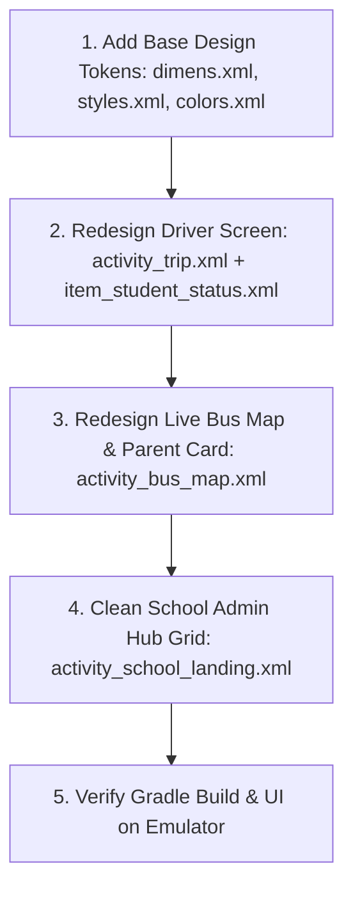

# Transport App: Material 3 XML Design System & Screen Refactor Plan

> **Goal**: Modernize the visual appearance of the app to a clean, professional Material Design 3 look without breaking existing Java logic or `findViewById` bindings. Practical, token-efficient, and tailored specifically to our Android XML codebase.

---

## 1. Principles & Safety Rules

1. **Zero Regressions on View IDs**: Never rename, remove, or change the type of an existing `android:id="@+id/..."`. Java Activities, ViewModels, and Adapters depend strictly on them.
2. **Material Design 3 (XML Native)**: Leverage existing `Theme.Material3.DayNight.NoActionBar` with standard Material Components (`MaterialCardView`, `MaterialButton`, `MaterialButtonToggleGroup`, `ChipGroup`, `Chip`).
3. **Ergonomic Road UI**: Touch targets for driver controls must be minimum 56dp (ideally 64dp) tall, with high-contrast text and distinct colored status chips.
4. **Calm, Trustworthy Parent UI**: Clear status badges, floating bottom sheet/card over the live map, and 1-tap emergency/contact buttons.
5. **Organized School Hub**: Replace the 900-line vertical button stack with a fleet summary header and a clean 2×2 tile grid with ripple feedback.

---

## 2. Step 1: Shared XML Design System

All screens share these tokens. We configure them in `res/values/` and `res/values-night/` first so individual screen redesigns stay simple and concise.

### A. Semantic Status Colors (`res/values/colors.xml` & `values-night/colors.xml`)

| Token Name | Light Value | Dark Value | Purpose |
|---|---|---|---|
| `status_success_container` | `#E6F4EA` | `#1E3A24` | Soft green background for Boarded / Arrived |
| `status_on_success` | `#137333` | `#81C995` | Dark green text/icon for Boarded / Arrived |
| `status_warning_container` | `#FEF7E0` | `#3D2E00` | Soft amber background for En Route / Pending |
| `status_on_warning` | `#B06000` | `#FDD663` | Dark amber text/icon for En Route / Pending |
| `status_error_container` | `#FCE8E6` | `#3E1C1A` | Soft red background for Absent / Emergency |
| `status_on_error` | `#C5221F` | `#F28B82` | Dark red text/icon for Absent / Emergency |
| `surface_variant` | `#F1F3F4` | `#2D2F31` | Nested cards, toggle tracks, headers |
| `outline_card` | `#E0E0E0` | `#3C4043` | 1dp subtle card border |

### B. Standard Spacing & Sizing (`res/values/dimens.xml`)

```xml
<?xml version="1.0" encoding="utf-8"?>
<resources>
    <!-- Spacing Scale -->
    <dimen name="spacing_xs">4dp</dimen>
    <dimen name="spacing_s">8dp</dimen>
    <dimen name="spacing_m">12dp</dimen>
    <dimen name="spacing_l">16dp</dimen>
    <dimen name="spacing_xl">24dp</dimen>

    <!-- Corner Radii -->
    <dimen name="radius_s">8dp</dimen>
    <dimen name="radius_m">12dp</dimen>
    <dimen name="radius_l">16dp</dimen>
    <dimen name="radius_pill">100dp</dimen>

    <!-- Touch Targets & Controls -->
    <dimen name="touch_target_driver">56dp</dimen>
    <dimen name="touch_target_action">60dp</dimen>

    <!-- Card Elevation -->
    <dimen name="card_elevation_default">2dp</dimen>
    <dimen name="card_elevation_raised">6dp</dimen>
</resources>
```

### C. Typography & Styles (`res/values/styles.xml`)

```xml
<?xml version="1.0" encoding="utf-8"?>
<resources>
    <!-- Screen Header -->
    <style name="TextAppearance.Transport.Header" parent="TextAppearance.Material3.HeadlineMedium">
        <item name="android:textSize">22sp</item>
        <item name="android:textStyle">bold</item>
        <item name="android:textColor">@color/text_primary</item>
    </style>

    <!-- Card Title -->
    <style name="TextAppearance.Transport.Title" parent="TextAppearance.Material3.TitleMedium">
        <item name="android:textSize">17sp</item>
        <item name="android:textStyle">bold</item>
        <item name="android:textColor">@color/text_primary</item>
    </style>

    <!-- Subtitle / Meta -->
    <style name="TextAppearance.Transport.Subtitle" parent="TextAppearance.Material3.BodyMedium">
        <item name="android:textSize">14sp</item>
        <item name="android:textColor">@color/text_secondary</item>
    </style>

    <!-- Badge / Status Pill -->
    <style name="TextAppearance.Transport.Badge" parent="TextAppearance.Material3.LabelMedium">
        <item name="android:textSize">13sp</item>
        <item name="android:textStyle">bold</item>
    </style>

    <!-- Elevated Material 3 Card Defaults -->
    <style name="Widget.Transport.Card" parent="Widget.Material3.CardView.Elevated">
        <item name="cardCornerRadius">@dimen/radius_l</item>
        <item name="cardElevation">@dimen/card_elevation_default</item>
        <item name="strokeColor">@color/outline_card</item>
        <item name="strokeWidth">1dp</item>
        <item name="cardBackgroundColor">@color/surface</item>
    </style>
</resources>
```

---

## 3. Step 2: Redesigning Priority Screens (One by One)

### Screen 1: Driver Road Screen (`activity_trip.xml` & `item_student_status.xml`)
- **Backing Logic**: `TripActivity.java`, `TripChecklistAdapter.java`, `TripViewModel.java`.
- **Preserved View IDs**:
  - `activity_trip.xml`: `@+id/tripStatusText`, `@+id/studentListRecyclerView`, `@+id/tripProgress`, `@+id/tripEmptyState`, `@+id/tripEmptyText`, `@+id/tripRetryButton`, `@+id/tripActionButton`.
  - `item_student_status.xml`: `@+id/studentNameTextView`, `@+id/studentDetailTextView`, `@+id/statusGroup`, `@+id/doneButton`, `@+id/notDoneButton`.
- **Visual Upgrades**:
  - Replace raw layout with a full-width `MaterialCardView` for each student item with 16dp rounded corners.
  - Convert `doneButton` and `notDoneButton` inside `MaterialButtonToggleGroup` to high-contrast segmented pill buttons (56dp tall) with soft container tinting when selected.
  - Sticky bottom `tripActionButton` (60dp height, rounded pill shape, bold text) with drop shadow so it remains glanceable and reachable on the road.

---

### Screen 2: Parent Dashboard & Live Bus Map (`activity_parent_landing.xml` & `activity_bus_map.xml`)
- **Backing Logic**: `ParentLanding.java`, `BusMapActivity.java`, `ParentDashboardViewModel.java`.
- **Preserved View IDs**:
  - `activity_bus_map.xml`: `@+id/busMap`, `@+id/busMapStatus`.
  - `activity_parent_landing.xml`: `@+id/parentChildRecyclerView`, `@+id/parentNotificationRecyclerView`, etc.
- **Visual Upgrades**:
  - Map fills the background; a sleek floating bottom card or bottom sheet card floats over the bottom portion.
  - Status header displays child avatar, child name, and a bold pill badge (e.g., "En Route", "Arrived").
  - Clear 3-step route progress line: `Picked Up` ➔ `En Route` ➔ `Arrived`.
  - Floating action buttons for driver phone call / chat message.

---

### Screen 3: School Admin Hub (`activity_school_landing.xml`)
- **Backing Logic**: `SchoolLanding.java`.
- **Preserved View IDs**:
  - Keep all existing card click IDs: `@+id/register_student_card`, `@+id/modify_student_card`, `@+id/delete_student_card`, `@+id/register_staff_card`, `@+id/modify_staff_card`, `@+id/delete_staff_card`, `@+id/register_vehicle_card`, `@+id/modify_vehicle_card`, `@+id/delete_vehicle_card`, `@+id/add_route_card`, `@+id/modify_route_card`, `@+id/delete_route_card`, `@+id/view_reports_card`, `@+id/schoolRefresh`.
- **Visual Upgrades**:
  - **Top Fleet Summary Card**: A clean Material 3 summary bar showing live fleet status (Active Buses, Students Tracked, Alerts).
  - **Categorized 2×2 Grids**: Instead of 900 lines of stacked full-width vertical buttons, group them into clean card grids:
    - *Students* (Add / Modify / Delete)
    - *Staff* (Add / Modify / Delete)
    - *Fleet & Vehicles* (Add / Modify / Delete)
    - *Routes & Reports* (Add / Modify / Delete / Reports)
  - Elevated `MaterialCardView` tiles with subtle ripple touch feedback, standard 16dp radii, and consistent iconography.

---

## 4. Execution Workflow

When prompting Claude or executing the work, do it in this exact order:



---

## 5. Copy-Paste Execution Prompts

### Prompt for Step 1: Base XML Tokens
```text
Please create/update our shared Android XML design tokens in res/values/ and res/values-night/:
1. In res/values/dimens.xml: Define standard spacing (spacing_s=8dp, spacing_m=12dp, spacing_l=16dp, spacing_xl=24dp), corner radii (radius_m=12dp, radius_l=16dp, radius_pill=100dp), and driver touch target heights (touch_target_driver=56dp, touch_target_action=60dp).
2. In res/values/colors.xml and res/values-night/colors.xml: Add status container pairs (status_success_container/status_on_success, status_warning_container/status_on_warning, status_error_container/status_on_error, surface_variant, outline_card).
3. In res/values/styles.xml: Define text styles (TextAppearance.Transport.Header, Title, Subtitle, Badge) and Widget.Transport.Card with 16dp corner radius and 1dp subtle stroke.
Do not modify any Java code. Ensure files are valid Android XML resources.
```

### Prompt for Step 2: Driver Road Screen
```text
Visually redesign activity_trip.xml and item_student_status.xml into a modern, high-contrast Material 3 Driver Road Screen:
1. Preserve every existing android:id="@+id/..." exactly (tripStatusText, studentListRecyclerView, tripProgress, tripEmptyState, tripEmptyText, tripRetryButton, tripActionButton, studentNameTextView, studentDetailTextView, statusGroup, doneButton, notDoneButton).
2. In item_student_status.xml: Wrap each student item in an elevated MaterialCardView with 16dp rounded corners. Use a MaterialButtonToggleGroup with 56dp minimum height buttons for doneButton and notDoneButton with large 18sp text and bold status feedback.
3. In activity_trip.xml: Make tripActionButton a sticky, prominent bottom button (60dp height, 18sp bold text, rounded pill corners).
Ensure the layout compiles with no broken view bindings in TripActivity.java and TripChecklistAdapter.java.
```

### Prompt for Step 3: Parent Live Bus Map & Card
```text
Visually redesign activity_bus_map.xml into a modern live tracking screen:
1. Preserve all existing android:id="@+id/..." exactly (busMap, busMapStatus, and toolbar include).
2. Have the MapView occupy the background, and overlay a floating MaterialCardView (with 16dp rounded top corners, elevation, and padding) displaying the trip status, ETA badge, and driver quick actions.
Ensure valid Android XML with no regressions.
```

### Prompt for Step 4: School Admin Hub
```text
Visually redesign activity_school_landing.xml from its current vertical button stack into a clean, modern Material 3 admin dashboard:
1. Preserve every single existing android:id="@+id/..." (schoolRefresh, register_student_card, modify_student_card, delete_student_card, register_staff_card, modify_staff_card, delete_staff_card, register_vehicle_card, modify_vehicle_card, delete_vehicle_card, add_route_card, modify_route_card, delete_route_card, view_reports_card).
2. Organize the actions into clean categorized sections with 2x2 grid layouts of elevated MaterialCardView tiles with custom vector icons, clear titles, and ripple touch feedback.
3. Add a top fleet summary card above the action categories.
Ensure SchoolLanding.java compiles and all click listeners bind without issues.
```
